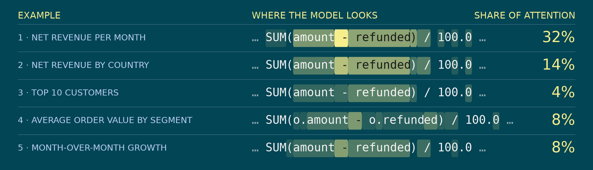

# Context drift: one convention, written once or copied into every example

The scenario, code, published runs and figures behind the Cassis talk at Forward Data Conference
2026, *Rules or examples: which is best?* Everything here reproduces offline from the published
data; re-running the experiments needs an Anthropic API key (behavioural half) or a GPU with the
open Gemma 4 weights (white-box half).

In one line: a house convention can be stated once as a rule or shown in every example query. An
example carries many conventions nobody wrote down, which is why examples help; it also means each
convention exists in several copies. We measure what happens when those copies disagree: on Claude
(Sonnet 5.5 and Haiku 5.5) by sampling SQL and scoring it, and on Gemma 4 12B by reading the
attention and the next-token probabilities at the one token where the convention is decided.



## The scenario

`src/scenarios/shop.py` (the same as data: `src/scenarios/shop.json`). A toy shop warehouse,
PostgreSQL, invented for the talk:

```sql
CREATE TABLE customers (customer_id bigint PRIMARY KEY, segment text, signup_at timestamptz);
CREATE TABLE orders (
  order_id bigint PRIMARY KEY, customer_id bigint REFERENCES customers, ordered_at timestamptz,
  status text, channel text, amount bigint, refunded bigint, country text
);
```

The house metric is net revenue. Seven conventions in three layers:

| layer | id | the rule sentence | in the SQL |
|---|---|---|---|
| metric | `net_refunds` | Net revenue is the order amount minus refunds. | `SUM(amount - refunded)` |
| metric | `completed_only` | Only completed orders count (status 'completed'). | `status = 'completed'` |
| metric | `exclude_test` | Test orders (channel 'test') are excluded. | `channel <> 'test'` |
| metric | `currency_units` | Amounts are stored in cents and reported in euros. | `/ 100.0` |
| date | `local_time` | Dates and times are in Paris time (timestamps are stored in UTC). | `ordered_at AT TIME ZONE 'Europe/Paris'` |
| output | `pct_scale` | Ratios are reported as percentages (0 to 100). | `100.0 * ...` |
| output | `pct_round` | Percentages are rounded to one decimal. | `ROUND(..., 1)` |

The one-line rule people actually write states the first two: *Net revenue = amount minus refunds,
for completed orders.* The standard example context is five queries that all rely on net revenue
(net revenue per month, by country, top 10 customers, average order value by segment,
month-over-month growth). All five show the four metric conventions, two show the date convention,
one shows the two output conventions: seven conventions written 24 times (figure 11).

Test questions: 14 "far" ones that are not near-copies of an example, and 5 "near" ones written to
resemble one example. Every question has a reference SQL. A "changed" (or "wrong") variant of an
example or a rule is a minimal edit that breaks one convention: three drop an operation (no
`- refunded`, no `channel <> 'test'`, no `/ 100.0`), one swaps a value (`status = 'delivered'`).

The schema is deliberately plain. A first version with self-explanatory names (`amount_cents`,
`is_test`, the status values in a comment, `src/scenarios/shop_v1.py`) let the models follow most
metric conventions with no context at all (Sonnet pilot: refunds 100%, test orders 93%, completed
79%, cents 56%), leaving nothing to measure. A well-named schema is context too. Its pilot runs are
in `results/runs/shop_v1/`.

## Behavioural half: Claude

- **Prompt**: one system sentence, then schema, optional rules, optional examples, the question.
  `src/talkdemo/prompt.py` is the only place that assembles text; `python src/run.py prompt ex5
  q_hour` prints one.
- **Models**: `claude-sonnet-5-5` with `thinking: {"type": "between_tools"}` and `claude-haiku-5-5`
  with `thinking: {"type": "disabled"}`: no thinking before the answer. Default sampling, one
  request per completion. A small check with Sonnet's default adaptive thinking is in the records
  (runner `claude-sonnet-5-5+thinking`) and changes nothing at its sample sizes.
- **Samples** per (condition, question): E1 5 on Sonnet, 10 on Haiku; E2 3 to 5 on Sonnet and 5 to 8
  on Haiku, so each cell holds 40 to 42 outputs on Sonnet and 60 to 70 on Haiku; E3 8 and 12
  (`PROTOCOL` in `src/run.py`).
- **Example order** is shuffled per (question, sample) with a seed that does not depend on the
  condition, and the k changed examples are the first k of a second seeded shuffle: conditions are
  paired and the k-of-5 contexts are nested.
- **Scoring**: one checker per convention on the sqlglot AST (`src/talkdemo/sqlcheck.py`) answers
  follows / violates / not applicable; a convention applies to a question when its reference SQL
  follows it. Nothing is executed: "wrong" means "does not follow the house convention". All 9,914
  scored replies parsed.

Conditions: `none` (schema only), `rule1` (the one-line rule), `rules` (the seven sentences), `ex1` /
`ex3` / `ex5` (the first 1, 3, 5 standard examples), `rule1+ex5`, `rules+ex5`; in E2, `rules:wrong`
(one rule stated wrongly), `ex5:1random`, `ex5:1nearest`, `ex5:2` ... `ex5:5` (k of the five
examples changed), and the rule-against-examples conflicts. The full tables for both models are what
`python src/run.py report` prints.

### E1, what transfers (far questions, Sonnet)

| | none | rule1 | rules | ex1 | ex5 | rules+ex5 |
|---|---|---|---|---|---|---|
| conventions the one-line rule does not state (pooled) | 1% (2/185) | 0% (0/185) | 100% (185/185) | 78% (145/185) | 96% (178/185) | 100% (185/185) |
| answers following every applicable convention | 0% (0/70) | 0% (0/70) | 100% (70/70) | 71% (50/70) | 90% (63/70) | 100% (70/70) |
| context tokens | 0 | 27 | 138 | 136 | 694 | 832 |

Haiku: 0%, 0%, 99%, 54%, 67%, 100% of answers follow every applicable convention. One example
transfers the five conventions it shows (100% each on Sonnet) and nothing it does not show. The
complete list of seven rules does as well or better, in a fifth of the tokens of five examples: the
measured advantage of examples is against the rule people actually write, which is incomplete. With
five examples, Sonnet's only failures are the one-decimal rounding, shown by one example of five.

### E2, change it in one place (far questions, Sonnet)

Share of answers that follow the changed copies (that break the house convention):

| context | `net_refunds` | `completed_only` | `exclude_test` | `currency_units` |
|---|---|---|---|---|
| all rules, this one changed (`rules:wrong`) | 100% (40/40) | 100% (42/42) | 100% (42/42) | 100% (40/40) |
| 5 examples, none changed (`ex5`) | 0% (0/40) | 0% (0/42) | 0% (0/42) | 0% (0/40) |
| 1 of 5 changed, a random one (`ex5:1random`) | 5% (2/40) | 0% (0/42) | 0% (0/42) | 0% (0/40) |
| 1 of 5 changed, the nearest one (`ex5:1nearest`) | 20% (8/40) | 0% (0/42) | 0% (0/42) | 0% (0/40) |
| 2 of 5 changed | 12% (5/40) | 5% (2/42) | 0% (0/42) | 2% (1/40) |
| 3 of 5 changed | 10% (4/40) | 95% (40/42) | 2% (1/42) | 28% (11/40) |
| 4 of 5 changed | 12% (5/40) | 100% (42/42) | 29% (12/42) | 88% (35/40) |
| 5 of 5 changed | 100% (40/40) | 100% (42/42) | 100% (42/42) | 100% (40/40) |

- A rule changed in its one place flips every answer; a change made in all five examples does too.
- One changed example of five is outvoted and leaves no trace in the answers (0 of 42 on the status
  value). In between, the answers follow the majority, unevenly per convention: the switch comes at
  three changed examples for the status value, four for the cents, five for the test orders.
  `net_refunds` stays low until all five change because the question says "net".
- **The one changed example that matters**: the 20% for `net_refunds` with the nearest example
  changed is two questions of ten at 100%, "average order value per month" and "median order value",
  whose nearest example is the average-order-value one. That example is the only place "order value
  is net of refunds" is written, and the seven correct rules do not protect it (Sonnet 8/8 answers
  drop the refunds with the rules present): the rule defines net revenue, not order value.
- **Rule against examples**: on Sonnet the full rule list wins both ways (1% wrong with the rules
  right and all examples changed, 99% with the rule wrong and all examples right). A rule in prose
  loses: the one-line rule says "for completed orders" and names no value; against five examples
  filtering on `'delivered'`, Sonnet writes `'delivered'` 42 times out of 42. On Haiku the outcome
  depends on the convention.

### E3, nearest-example effect (near questions)

A changed example that is not the nearest one never changed an answer (0/160 on Sonnet, 0/240 on
Haiku). With the nearest one changed, `currency_units` is the convention most copied (Sonnet 42%,
Haiku 85%; on the growth question a missing `/ 100.0` cancels out in the ratio).

### What we would not claim

- Not "examples transfer conventions better than rules": the complete rule list scored 100% on both
  models with fewer tokens.
- Not "one bad example poisons the context": one changed example of five changed 1% of Sonnet's far
  answers. It matters when the question resembles that example, and decides it when that example is
  the only definition of the figure asked for.
- Not a statement about models in general (two Claude models, thinking off, one prompt format) or
  about real contexts (two tables, seven conventions, 19 questions written by the same hand as the
  examples, single turn, no tools, no retrieval).
- Sample sizes are 20 to 70 per cell on Sonnet; the 100%-versus-0% contrasts are safe, ten-point
  differences are not.

## White-box half: Gemma 4 12B

The same prompts (built by the same `build_prompt`), read inside an open model,
`google/gemma-4-12B-it`, bf16, through Hugging Face transformers. The chat template is rendered
with `enable_thinking=False`, which ends the prompt with an empty thought channel, so the SQL is
what follows the prompt and the reference SQL can be teacher-forced there.

- **One token, two alternatives.** For a question and a convention, the scenario gives the prefix
  of the reference SQL after which the next token decides (`shop.decision_points.jsonl`). The
  measurement is `log P(follows) - log P(violates)` in nats, teacher-forced, no sampling, and the
  two-way probability `P(follows) / (P(follows) + P(violates))`. Both continuations are tokenised
  whole; the first token where they differ is the decision token (`src/whitebox/wb/tokens.py`).
- **Changed in k of 5** (`perturb`): every subset of the examples carrying the convention is changed,
  with the rules absent, right or wrong.
- **Attention only from causally selected heads.** Every one of the 768 heads (48 layers x 16) is
  patched between a clean prompt (the five examples as written) and a corrupt one (every example
  changed) at the decision position; heads are ranked by the share of the log-odds gap they restore,
  summed over the tested questions, and the picture for a question uses the top 12 heads ranked on
  the **other** questions. The average over all heads spreads over the whole prompt and shows
  nothing. Gemma 4 applies an RMSNorm to the sum of the heads before the residual, so head outputs
  are not additive: the share carried by the top heads is measured by patching them jointly.
- **Every layer sees the whole prompt**: the longest prompt, reference SQL included, is about 820
  tokens, under the 1024-token sliding window of 40 of the 48 layers (`run.py info` checks it).
- **Two cautions.** The read-out is teacher-forced on the reference SQL, so it answers "given this
  much of the house query, what comes next", not "what would the model write"; the `sample` step
  generates 20 answers per cell as the check. And integrated gradients do not hold on the 12B in
  bf16: the backward-pass slopes do not match forward differences, so `figures.py` draws a gradient
  map only where the path sum closes; `claims.py` computes exact Shapley values of each example from
  the exhaustive `perturb` subsets instead.

What the talk shows: on "What was our net revenue in 2025?", after `SELECT SUM(amount`, the selected
heads look at the same place in every example, the minus sign after `SUM(amount` (five tokens of 622
get 27% of the attention; figure 14). With example 3 changed, the picture barely moves and the model
still subtracts the refunds. Across the net-revenue questions, the probability of following the
changed examples rises with their number: 0%, 5%, 12%, 26%, 72%, 100% for 0 to 5 changed
(figure 15). The figures and numbers of the rest of the white-box run (the grid of conditions, the
heads, the order-value example, rule against examples at the status token, the sampled check) are
in `results/whitebox/` and print with `summary.py` and `claims.py`.

## Reproduce the figures and numbers (offline, no API key, no GPU)

```bash
python -m venv .venv && .venv/bin/pip install -r requirements.txt
.venv/bin/python -m pytest -q tests                   # 360 pass; the white-box plumbing tests skip without torch
.venv/bin/python src/talk_numbers.py                  # every number on the slides, recomputed and compared
.venv/bin/python src/talk_numbers.py --rescore        # also re-score all 9,914 published replies
.venv/bin/python src/talk_figures.py                  # images/07, 11, 15, 16
.venv/bin/python src/attention_heatmap.py             # images/14-attention-{clean,changed}.png
.venv/bin/python src/run.py report                    # the E1/E2/E3 tables -> out/report/shop/
.venv/bin/python src/whitebox/summary.py --out results/whitebox/shop
.venv/bin/python src/whitebox/claims.py  --out results/whitebox
.venv/bin/python src/whitebox/figures.py --out results/whitebox/shop --figures out/whitebox-figures/shop
```

`src/run.py show` prints stored replies (`--runner claude-sonnet-5-5 --exp e2 --condition ex5:4
--target currency_units --status currency_units=violates`), and `src/talkdemo/inspect_values.py`
lists the status values the replies filter on.

## Where each number on the slides comes from

`python src/talk_numbers.py` recomputes every row below from the published files and prints the
slide value next to the recomputed one; it exits non-zero if a number differs. Slide numbers follow
the talk's deck. Records are under `results/runs/shop/records/<runner>/`; Sonnet is
`claude-sonnet-5-5`.

| Slide | On the slide | Value | Data | Figure |
|---|---|---|---|---|
| 7 | Sonnet 5.5, 14 questions, 5 runs each: answers following every applicable convention, no context / seven rules / five examples | 0% / 100% / 90% (63 of 70) | Sonnet `e1.jsonl.gz`, conditions `none`, `rules`, `ex5` | `talk_figures.py` -> `07-every-convention.png` |
| 7 | The failures are the rounding of ratios to one decimal; 4 questions need it, answers inconsistent over the 5 runs on 3 of them | `pct_round` only; 4; 3 (rounded 2/5, 2/5, 4/5, 5/5) | Sonnet `e1.jsonl.gz`, `ex5` | |
| 7 | Haiku 5.5 with five examples | 67% (94 of 140) | Haiku `e1.jsonl.gz`, `ex5` | `07-every-convention.png` |
| 9 | Convention changed everywhere: answers following the new rule / the new examples, four conventions | 100% / 100%, 164 answers each | Sonnet `e2.<convention>.jsonl.gz`, `rules:wrong` and `ex5:5` | |
| 10 | "Which 5 days had the highest net revenue?": one rule against one example, conventions applied, same answer in all 5 runs | 2 against 5 | Sonnet `e1.jsonl.gz`, `rule1` and `ex1`, question `q_best_days` | |
| 11 | Seven conventions written 24 times across the five examples (5, 5, 5, 5, 2, 1, 1) | 24 | `src/scenarios/shop.py` (`Scenario.applies`) | `11-overlap.png` |
| 12 | One drifted example of five: answers following it on the status value; on the four conventions | 0 of 42; 2 of 164 | Sonnet `e2.<convention>.jsonl.gz`, `ex5:1random` | |
| 13 | Gemma 4 12B, 12 heads selected causally out of 768, at the token after `SUM(amount` | 12, 768 | `results/whitebox/shop/attention.json.gz` (cell `net_refunds` / `q_year`), `heads.json.gz` for the ranking | |
| 14 | Attention share per example, five correct examples / example 3 changed | 32/14/4/8/8, 30/14/5/10/9 | `attention.json.gz`, contexts `examples_clean` and `one_example_broken`, map `selected_heads` | `attention_heatmap.py` -> `14-attention-{clean,changed}.png` |
| 14 | The five minus signs get 27% of the attention (5 tokens of 622); the five examples 67% in total | 27%, 622, 67% | `attention.json.gz`, `examples_clean` | `14-attention-clean.png` |
| 15 | Probability that Gemma follows the changed examples, 0 to 5 changed | 0, 5, 12, 26, 72, 100% | `results/whitebox/shop/perturb.json.gz`, rows `net_refunds`, no rule | `talk_figures.py` -> `15-gemma-dose.png` |
| 16 | Claude, answers following the changed examples, 0 to 5 changed: status value / cents to euros / test orders | 0,0,5,95,100,100 / 0,0,2,28,88,100 / 0,0,0,2,29,100 | Sonnet `e2.<convention>.jsonl.gz`, `ex5`, `ex5:1random`, `ex5:2` ... `ex5:5` | `talk_figures.py` -> `16-claude-dose.png` |

Notes on reading the slides against the data (the script prints them as `note` lines):

- Slide 10 shortens the one-line rule; the model was given "Net revenue = amount minus refunds, for
  completed orders." The two outputs on the slide are the model's, laid out; the five runs give the
  same SQL up to whitespace.
- Slide 12 draws the drifted copy in example 2. In the experiment the changed example is drawn at
  random per (question, sample): over the 42 answers each of the five examples was the changed one
  between 5 and 11 times.
- Slide 15 explains the measurement on one question (`SELECT SUM(amount`). The numbers are the mean
  of the two-way probability over the 15 questions `net_refunds` applies to and over every subset of
  k changed examples. On "What was our net revenue in 2025?" alone they are 0, 0, 0, 4, 49, 100%.
- Slide 16's "2%" for cents with two changed examples is 1 of 40 (2.5%), printed as 2% by the result
  tables; the k = 1 column is a random changed example (the nearest one also gives 0, 0, 0).

## Re-run the behavioural half (Anthropic API)

```bash
export ANTHROPIC_API_KEY=...
.venv/bin/python src/run.py tokens --model claude-sonnet-5-5      # context sizes (token-counting endpoint)
.venv/bin/python src/run.py final --model claude-sonnet-5-5       # E1, E2, E3 with the published sample counts
.venv/bin/python src/run.py final --model claude-haiku-5-5 --workers 12
.venv/bin/python src/run.py --results out/runs report             # tables from your runs -> out/report/shop/
```

New runs are written to `out/runs/` and never overwrite the published files. Replies are cached in
`cache/` (git-ignored), keyed by model, thinking setting, prompt and sample index: a re-run costs
nothing, deleting the cache re-samples. `--budget` (default 14 USD) is a hard stop on spend; `python
src/run.py spend` shows it. The published runs cost 7.90 USD on Sonnet and 0.43 USD on Haiku
(11.21 USD in all with pilots and the thinking check). Single experiments: `src/run.py run e2
--model claude-sonnet-5-5 --samples 4 --conv net_refunds`; the thinking check adds `--thinking
default`. Sampling is not seeded on the API side, so a re-run reproduces the rates, not the replies.

## Re-run the white-box half (GPU, open weights)

Needs `google/gemma-4-12B-it` from Hugging Face (accept the Gemma licence there and log in with
`huggingface-cli login`) and a CUDA GPU with about 48 GB. The published session ran on one NVIDIA
L40S in about two hours.

```bash
.venv/bin/pip install -r requirements-gpu.txt
.venv/bin/python -m pytest -q tests                           # + 25 plumbing tests on a random-weight Gemma 4 (CPU is enough)
.venv/bin/python src/whitebox/run.py info --scenario shop     # tokenizer only: token counts, decision alignment
```

The published directories, step by step (each writes JSON to `--out`):

```bash
R=".venv/bin/python src/whitebox/run.py"
$R all --scenario shop --out out/whitebox/shop --opt n_far=99

AOV=(--scenario shop --out out/whitebox/shop-aov --opt picture_break=4 --opt picture_other=2)
Q=q_aov_month,n_aov_country,q_median,q_year,q_hour,n_week
$R grid "${AOV[@]}" --opt picture=net_refunds --opt 'conditions=["none","rules_all","ex5","rules+examples","picture:"]'
$R heads "${AOV[@]}" --conventions net_refunds --questions $Q --opt corrupt_context=one_example_broken
$R attention "${AOV[@]}" --conventions net_refunds --questions $Q \
  --opt 'contexts=["examples_clean","one_example_broken","one_example_broken+rules","other_example_broken","rule_only","examples_broken"]'
$R gradients "${AOV[@]}" --conventions net_refunds --questions q_aov_month,q_year \
  --opt 'contexts=["examples_clean","one_example_broken","one_example_broken+rules","other_example_broken"]'
$R sample "${AOV[@]}" --questions $Q --opt picture=net_refunds \
  --opt 'conditions=["picture:examples_clean","picture:one_example_broken","picture:one_example_broken+rules","picture:other_example_broken"]'

ST=(--scenario shop --out out/whitebox/shop-status --conventions completed_only)
$R heads "${ST[@]}" --opt clean_context=rule_only --opt corrupt_context=rule_wrong_only
$R attention "${ST[@]}" --opt 'contexts=["rule_only","rule_wrong_only","rule_vs_examples","rule_wrong_vs_examples","one_line_vs_examples","one_line_wrong_vs_examples","examples_clean","examples_broken"]'
$R gradients "${ST[@]}" --opt 'contexts=["rule_vs_examples","rule_wrong_vs_examples","one_line_vs_examples","one_line_wrong_vs_examples"]'

$R gradcheck --scenario shop --out out/whitebox/shop --conventions completed_only,currency_units --opt path_points=64
$R gradcheck --scenario shop --out out/whitebox/shop-gradcheck-blank --conventions completed_only --opt ig_baseline=blank --opt path_points=64
$R gradients --scenario shop --out out/whitebox/shop-ig256 --conventions net_refunds --questions q_aov_month \
  --opt picture_break=4 --opt picture_other=2 --opt ig_steps=256 --opt 'contexts=["examples_clean","one_example_broken+rules"]'
```

Then point the offline commands at `out/whitebox/` instead of `results/whitebox/`. Teacher-forced
read-outs are deterministic up to GPU kernel nondeterminism in bf16; the sampled check is not.
`--tiny` swaps in a random-weight model for a dry run of any step on a laptop (its files are
stamped `dry_run_random_weights`). The `attention` step also writes `attention.npz`, the raw
attention rows, which is not published.

## Layout

```
src/scenarios/        the scenario (shop.py) and its export (shop.json, decision points); shop_v1 = the dropped first version
src/talkdemo/         prompt builder, convention checkers, Claude runner, experiments E1-E3
src/run.py            behavioural command line (prompt, run, final, report, show, tokens, spend)
src/whitebox/         white-box command line (run.py), offline readers (summary.py, claims.py, figures.py), wb/ internals
src/talk_numbers.py   every number on the slides, recomputed from results/
src/talk_figures.py   the talk's charts -> images/
src/attention_heatmap.py  the slide-14 heatmaps -> images/
tests/                checkers, scenario, builder, published data; tests/whitebox: plumbing on a random-weight Gemma 4
results/runs/         published Claude replies, one JSON line each (see its README)
results/whitebox/     published Gemma 4 12B outputs, one JSON per step (see its README)
images/               the figures, regenerable with the commands above
out/, cache/          everything the scripts write (git-ignored)
```

## License

Code, text and data: MIT (see the repository root). The scenario and every row of data are
synthetic, invented for the talk. Gemma 4 weights are subject to Google's Gemma terms; none are
included here.
