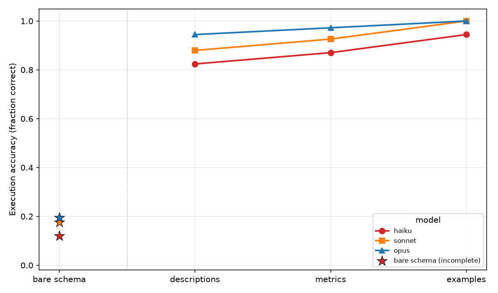
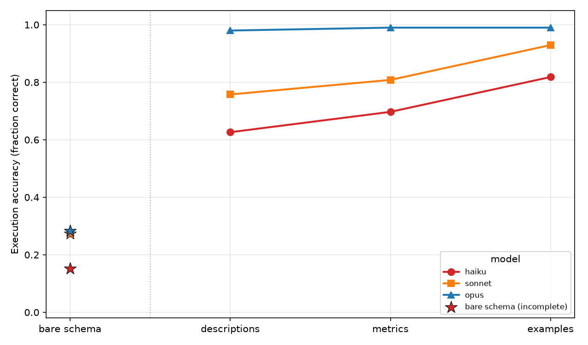
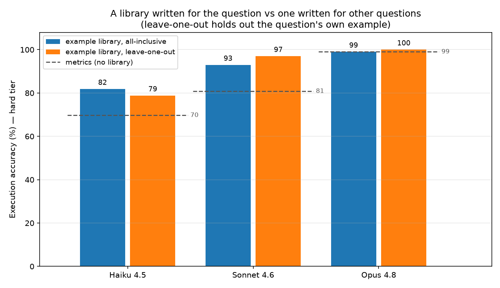
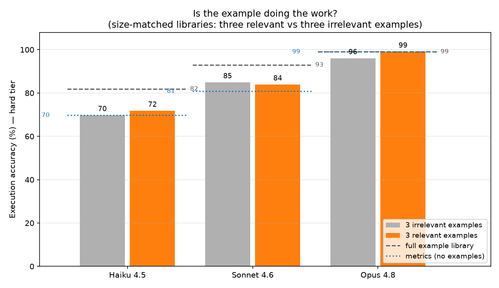
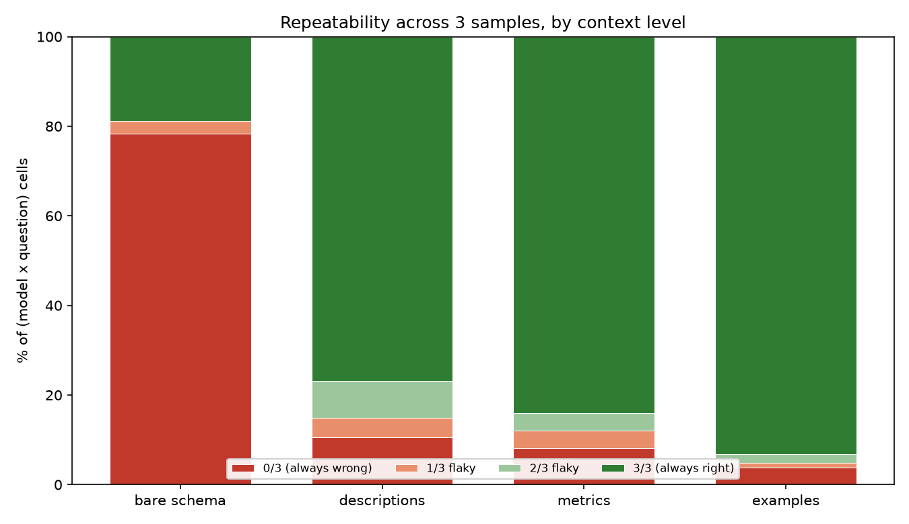
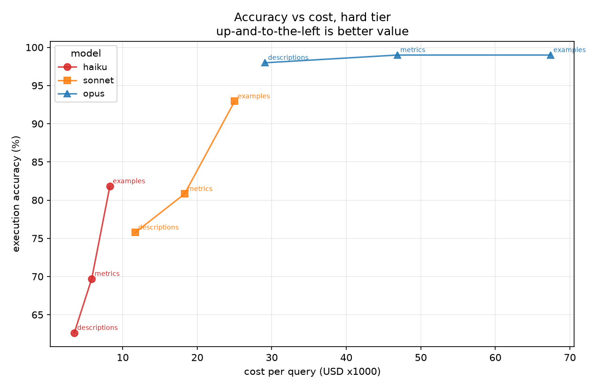

How much does spelling things out help? Measuring the effect of derivation distance

It started from an intuition. Why are examples so often recommended to help LLMs perform well? For our brains, it's clearly easier to adapt an example than to reconstruct a solution from scratch. Is it the same for LLMs, does it make it easier for the model if it has less "thinking" to do to get from the information it's given to the answer? Can we measure that?

We set out to evaluate that. We called this supposed property of a model's context "derivation distance": how far a model has to travel from the context you show it to the answer it gives. This study is focused on data analytics use cases, but findings should generalize well. It's easy to run a similar experiment on your own use cases, I'd be interested in the results if you do!

This post is the story of how we studied that, because the wrong turns are also interesting. They surface what makes a good context.

## The setup

We started from three public analytics datasets: jaffle-shop (a toy cafe chain), theLook (a synthetic e-commerce store), and Olist (a real Brazilian marketplace export). Each comes with a context layer that we initially built to test Cassis: tables & column descriptions, business rules written in prose, and named metrics with their SQL. For each, we also generated natural-language questions with known answers.

The questions come in two tiers. The standard tier is straightforward: "what is our total revenue," "what is revenue by store for the top five stores," "what is our average order value." One aggregate, one or two joins, done. The hard tier is multi-step composition: "what is the month-over-month revenue growth rate for each month" needs a CTE that aggregates to months and then a LAG window function that compares each to the one before. "What is each store's share of total company revenue" needs a window SUM over a grouped aggregate. "How many customers spent more in the last 90 days than in the 90 days before that" needs two non-overlapping date windows, per-customer conditional aggregation, and a comparison. These are not trick questions, and we wrote them so that the rules stated in the context would pin down a single answer (we did not fully succeed on the first try, as you will see). We will come back later to their purpose.

For each question we render the context at a series of levels supposed to vary the derivation effort, and hand it, with the question, to a model. The model writes SQL, we run it against the actual database, and compare the result to the known answer. We do this for three models spanning a wide capability range (Haiku 4.5, Sonnet 4.6, Opus 4.8), repeat each cell three times to catch flakiness, and count a model that writes invalid SQL as wrong. That makes for a total of 2,484 runs.

The grading deserves a paragraph, because it turned out to be one of the wrong turns. The base comparison is standard execution accuracy: treat the result set as an unordered bag of rows, ignore column names (models alias freely), round floats to four decimals. Our first grader stopped there, and an audit of its failures showed that roughly a third of them were answers with verifiably correct values in the wrong shape: a `ROUND(x, 2)` on a growth rate, an extra column showing the previous month next to the growth figure, a date where the reference answer had a midnight timestamp. Nothing in the prompt told the model which shape to produce, so exact-match grading was punishing unstated conventions, and it distorted every curve, always in favor of the models that happened to share the grader's taste. So the grader now accepts presentation variants of the correct answer: the requested values in any column order, with extra columns alongside, at the model's own display precision (two decimals minimum), and treating a date and a midnight timestamp as the same instant. It still rejects anything that changes the values themselves: a fraction where a percentage was asked, an entity ID where a name was asked, a missing column. All numbers below use this grading.

## The first curve, and why it didn't say much

The first version of the ladder did the simplest thing. Level zero was bare table & column names. Each level added more elements of the context layer, from descriptions to formulas to worked examples. More context = less derivation effort, right? The curve looked exactly like the theory predicted: accuracy rose steadily as we added context, the weak model rose more steeply than the strong one, everything fanned out nicely. But it measured the wrong thing for a simple reason: at level zero, with only tables and column names, the model had no idea of the business rules such as how revenue should be measured. Each run at level 0 pretty much amounted to rolling dice. Even worse, it did not have temporal information about the dataset, so all time-related questions could not be answered.

So of course, as you add this information, the answers get better. But what this measured is not **derivation distance**, it is **completeness**. Whether all the information required is present in the context, under one form or another. And yes, completeness improves results, but that's not exactly breaking news.

So we reworked our context levels to compare only contexts that were complete, but actually varied the derivation distance.

## Holding completeness constant

The fix for completeness is easy in theory: make sure every level has all the facts. So we reworked our context levels to vary only the way the information is presented. First, the facts are just present in plain English, scattered across tables and columns descriptions. The next level adds structured metrics with their names, descriptions and SQL expressions. The last one includes a library of examples. For each question, we generated one example query that answers a very similar but not identical question. All the examples were included in the context, so for all questions, the model saw the same context.

Now with completeness constant, we should be able to measure derivation distance. And it seemed that it actually did make a difference.

On the standard question tier, the gradient is real but modest. Pooled across the three datasets, Haiku goes from 82% at the terse-but-complete baseline to 87% with metrics and 94% with examples. Opus barely needs the help: it starts at 94% and reaches 100% with the example library. A context with minimal derivation distance is able to get even the smallest models to very good accuracy.

But this benchmark is saturated, Opus and Sonnet reaching 100% means the variation in the results could be mostly measurement error. This is why we introduced the harder tier of questions.

On the hard tier the models separate cleanly. Opus runs close to the ceiling from the start: 98% on terse descriptions, 99% with metrics and with examples. The smaller models climb the whole way up. Metrics add a handful of points over descriptions (Haiku 63% to 70%, Sonnet 76% to 81%), and examples add twelve more for each, to 82% and 93%:

The harder benchmark separates both the models and the context levels more significantly. For the smaller models, rules tell them what to do but examples show them how, and the example library helps more than the whole metrics layer. For Opus the curve is nearly flat, because it is already able to answer all the questions from English rules.

## How to interpret this?

Let's dive into what the models actually see.

For instance, on the question "what is the month-over-month revenue growth rate for each month?", with metrics, the model sees this:

    revenue
    - Expression: SUM("SUBTOTAL")
    - Table: JAFFLE.ORDERS

That formula clearly tells how revenue is measured. It says nothing about how to compose a monthly aggregate with a window function. The model has to invent the CTE, pick `date_trunc`, figure out `LAG`, and wire the growth-rate arithmetic. When the example library is in the context, among two dozen other solved questions the model finds this:

    ## What is the month-over-month order-count growth rate (%) for each month?

    WITH monthly AS (
      SELECT date_trunc('month', ORDERED_AT) AS month, COUNT(*) AS orders
      FROM ORDERS GROUP BY 1
    )
    SELECT month, orders,
           100.0 * (orders - LAG(orders) OVER (ORDER BY month))
                 / LAG(orders) OVER (ORDER BY month) AS growth_pct
    FROM monthly ORDER BY month

Not the same question, but the same shape. Swap `COUNT(*)` for `SUM(SUBTOTAL)` and you're done. Much easier!

The capability gap between models is widest before examples enter. At plain descriptions, Opus already clears 98% of the hard tier while Haiku sits at 63%. The stronger model tolerates the simpler context; the weaker one needs the demonstration.

## The wrong turn that was hiding in the context

The clean curves above took one more detour to earn. On our first pass over this grid, Opus did something strange on the hard tier: it scored better with terse descriptions (86%) than with the full metrics layer (77%). Adding context was making the strongest model worse. We studied the failures question by question. Five questions carried the entire decline, and three of them consistently failed the moment a specific context section entered, two of them going down from a perfect 3/3.

Reading the failing SQL next to the context showed what changed, and it was not the model's reasoning. The context was contradicting our own answer key.

- The catalog notes for one dataset said to report products with no category "as uncategorized rather than dropping them silently". The reference answer keeps them as a NULL-labeled group. With terse descriptions Opus produced the NULL group and passed; once the prose entered the context, it did what the prose said, labeled the group 'uncategorized', and got marked wrong.
- The metrics prose said "use the metric definitions exactly; do not re-derive them", and the revenue metric filters to delivered orders. On a cohort question, Opus applied that filter everywhere, including to the first-purchase date that defines the cohort, where the reference answer considers all orders.
- The rest sat on questions with two defensible readings, like "last 90 days" with an open or a closed upper bound, where the reference answer took one reading and nothing in the context said which.

The decline was real, but the defect was in the benchmark. A stronger model is also a more obedient one: it reads everything you give it and does what the words say, so every contradiction and every unstated convention in the context becomes a place where it can faithfully diverge from what you meant. The weaker models made the same relabeling and the same window choices; they just had less accuracy to lose.

This highlights how easy it is to inadvertently introduce contradictions in the context, and their devastating effect on performance.

So we fixed the context. We pinned the window convention, scoped metric filters to the measures they define, aligned the category rule with the reference answers, reworded one question that asked about "US states" while its answer counted every country, and trimmed four reference answers that returned columns nobody asked for. On the twenty affected questions, Opus went from 70% at descriptions and 47% at metrics to 93% and 100%. The grids in this post come from a fresh run on the fixed contexts.

The lesson: when a model gets worse as you add context, look for a contradiction before blaming the model. And sometimes, removing context can be better.

## Are we just testing retrieval?

Because of the way our test set was built (one example similar to each question), it would be fair to ask whether we're testing the ability of the model to retrieve the matching example, rather than its ability to generalize from a set of examples. The former is much less useful than the latter, as you obviously can't write examples for every possible question.

So we ran another version of the test, leave-one-out: for each question the example library is rebuilt from all the *other* questions, with that question's own analogue held out. The model gets a gallery written for a different set of questions, targeting the same tables and has to generalize from it.

| hard tier, accuracy | metrics | example library, all-inclusive | example library, leave-one-out |
|---|---:|---:|---:|
| Haiku 4.5 | 70% | 82% | 79% |
| Sonnet 4.6 | 81% | 93% | 97% |
| Opus 4.8 | 99% | 99% | 100% |

Removing the question's matching example changes very little: Haiku slips three points, Sonnet and Opus land at or above their all-inclusive scores. The example library generalizes well: its value comes from examples written for other questions on the same tables, not from finding the one that matches. This is not a retrieval test. And examples can help answer adjacent questions, not only the one question they were written for.

We nearly concluded the opposite, twice. Under the original exact-match grader, holding out the matching example appeared to cost around 18 points, and the library looked like a lookup table. The grading audit showed that without its twin to imitate, the model still computed the right numbers but formatted them its own way, and the strict grader failed the lot: the matching example was teaching form as much as substance. Fair grading shrank the penalty to a few points, and the context fixes mostly erased those too.

Note: We ran the same comparison with a heavier gallery of near-complete answer templates instead of the examples (the gold query with a single value blanked). This was initially our lowest derivation distance test set, but we removed it as it was completely unrealistic. Including all templates in the context, every model scores 99% or 100%. Leaving the matching one out, the scores fall back to the same range as the held-out examples: Haiku 78%, Sonnet 90%, Opus 100%. A template gallery has no edge over an example gallery once you stop testing it on questions it already answers.

## Is the example doing the work, or just sitting there?

The held-out library still helps, but one could make a fair objection: maybe *any* example would, just by showing the model what a SQL query against this schema & warehouse looks like, and not how these specific tables are used. So we built two libraries of the same size, three examples each: the three most relevant other examples, selected by shared tables and query shape, against the three least relevant. Same amount of context, same number of examples. If the content carries information, the relevant set wins; if it is generic priming, the two tie above the baseline; if the examples are dead weight, they tie at it.

| hard tier, accuracy | no examples | 3 irrelevant examples | 3 relevant examples |
|---|---:|---:|---:|
| Haiku 4.5 | 70% | 70% | 72% |
| Sonnet 4.6 | 81% | 85% | 84% |
| Opus 4.8 | 99% | 96% | 99% |

The answer surprised us: on the fixed contexts, a handful of examples adds nothing at all. Three irrelevant examples leave every model within noise of its no-example baseline, and three hand-picked relevant ones don't do much better. The lift only appears with the full two-dozen example library, which takes Haiku from 70% to 82% and Sonnet from 81% to 93%.

Before the context consistency fixes this check had told a different story, with three relevant examples recovering about half of the library's value; much of what those examples were "teaching" was conventions (which reading of a window, how to label a group) that the rules now pin down. There is also an aside here for benchmark builders: under exact-match grading, even irrelevant examples had looked six to seven points helpful to the smaller models, and that entire effect was formatting.

Our first suspect was the selection. Maybe our similarity heuristic just picks the wrong three, and a better retriever would close the gap. We checked which example each successful library run actually imitates, and indeed our heuristic's top three only contains it about half the time. So we rebuilt the three-example arm twice: once selecting by question-text similarity (what a production retriever would see), and once selecting by token overlap with the reference answer itself, a cheating selector that provably includes the example the models imitate. Neither moved the needle: Haiku 72% and 73% against 82% with the library, Sonnet 88% and 85% against 93%. Having the right example in a three-example context is not the same as having it in a two-dozen-example context.

So what survives every correction is the breadth of things covered by the examples. Examples help the smaller models as a library: enough patterns that any question finds a structural cousin, plus a surrounding gallery that establishes the house style and fills in the small conventions the winning example does not carry. This is counterintuitive, as [increasing the context size usually degrades performance](https://arxiv.org/abs/2502.05167). There's most likely diminishing returns to this, but the optimal number of examples is higher than we expected.

## Where the noise lives

We ran every cell three times, which lets us ask a separate question: when a model gets one of these right, is it reliable, or did it get lucky? The answer is reassuring and useful. Across all 828 question-by-context-by-model cells, the three runs agree completely 93% of the time. Either all three fail or all three succeed.

The 7% that disagree are not spread evenly. They pile up in the middle of the ladder (13% of cells are flaky at the descriptions level, 8% at metrics) and thin out at both ends (3% at bare schema, 3% with the example library).

At bare schema almost everything reliably fails. At the top of the ladder, with a library to copy from, almost everything reliably succeeds. Before the convention fixes, the recurring flaky cells sat on questions with two defensible readings, "customers in the last 90 days" with an open or closed boundary, top-five with or without ties: the model alternated between two reasonable interpretations, so the variance lived in the question, not the model. Pinning those conventions is part of what thinned the band. What remains sits where a model has all the facts but no worked pattern to anchor on.

## Accounting for the cost

So far we've looked only at accuracy. As we're seeing more and more folks getting burned by token costs, it would be foolish not to take that into account.

A query's output here is a short SQL statement, a couple hundred tokens, and thinking stayed near zero across the whole run, so spend is dominated by the context you send in. More spelled-out context is not free, it is more input tokens on every single call. On the hard tier a query costs between 1,000 and 2,000 input tokens at bare schema and between 7,000 and 12,000 with the example library, and the cost scales with it. The graph below shows the cost of each model & context combination, at current API prices.

Adding examples to a cheap model buys accuracy at a fraction of the price of a model upgrade: Haiku with the example library reaches 82% at about $0.008 per query, more than Sonnet on metrics alone at twice the spend. The strongest model rewrites the top of the chart though. Opus reaches 98% on nothing but terse descriptions at $0.029 per query, higher accuracy than Sonnet carrying the full example library at about the same price, and its own examples rung adds one point for three times the tokens. Once the context is consistent, the strong model does not need it spelled out. It needs it lean.

Another thing to keep in mind is that this test is only for a single question and answer. Real analytics work drills down into causes over a thread, and multi-turn evaluations show every model losing ground there: [across 15 models](https://arxiv.org/abs/2505.06120), performance dropped 39% on average from single-turn to multi-turn conversations, at every capability tier. The strongest models still keep the highest absolute scores in the multi-turn setting, so the ranking you see here should hold over a longer conversation, just at a lower level.

## The hidden costs

It's tempting to read these results as "add examples", and for the smaller models this holds up to the different checks that we made.

However, one thing that we haven't accounted for, and that proved very hard even in this small benchmark, is the cost of keeping everything consistent.

It's easy to write down a set of rules that are independent from one another. It's much harder with a set of examples: joins, metric computations, query patterns will typically be reused across many examples. So examples will repeat information already present in other examples, and they may also rephrase information already stated in the surrounding rules. Information duplication creates a significant risk of inconsistencies whenever the context is edited. And nothing kills performance quicker than an inconsistent context: the wrong turn above shows exactly what that looks like, and it only took one contradictory sentence.

## So which one do you choose?

The answer will depend on the use case. For data analytics, where it's tempting to start with a simple question, and then dig into why we're getting a certain number over several turns, the largest models keep the highest accuracy in multi-turn conversations. These models also need less spelling-out than the smaller ones. Opus clears 98% of the hard tier from terse descriptions alone, before a single formula or example enters the context. This means you can get away without examples, lowering the risk of inconsistencies over time, and greatly facilitating context maintenance.

On other use cases where consistency over long threads is not as important, a mid-tier model with a good example library can still provide great performance.

And for every model below the top tier, examples help much more than rules.
